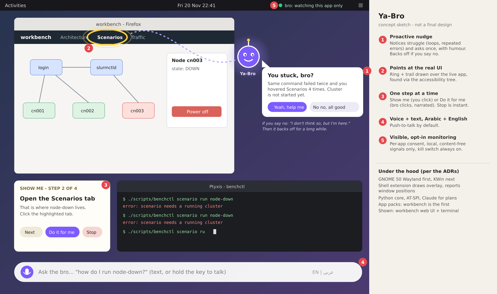

# Ya-Bro

> *"Ya bro!"* — call your companion when an app confuses you.

Ya-Bro is a Linux desktop sidekick that hovers on your screen. It notices when you're stuck ("you stuck, bro?") or you can just ask it (by voice or text) how to do something in any app, and it walks you through the **real app, one step at a time** — pointing at the exact button, explaining why, and doing the step for you whenever you'd rather just watch.



*Concept sketch (source: `docs/assets/ya-bro-concept.svg`), not a final design.*

**Status:** pre-alpha. Project skeleton in place (interfaces, fakes, CI); no user-facing features yet. Progress: [docs/PROGRESS.md](docs/PROGRESS.md). See [SPEC.md](SPEC.md).

## Docs
- [SPEC.md](SPEC.md) — what we're building and why
- [docs/PRIOR_ART.md](docs/PRIOR_ART.md) — who else is doing this
- [docs/adr/](docs/adr/README.md) — architecture decisions, risks and MVP build plan
- [docs/research/](docs/research/) — how other AI and non-AI tools work, and Linux platform facts
- [CLAUDE.md](CLAUDE.md) — contributor/agent workflow (issues → PR to `dev` → release to `main`)
- [docs/DEVELOPMENT.md](docs/DEVELOPMENT.md) — setup, validation script, layout
- [docs/PROGRESS.md](docs/PROGRESS.md) — milestone and issue status
- [CHANGELOG.md](CHANGELOG.md)

## broctl
`broctl` controls Ya-Bro, like `kubectl` controls a cluster: `broctl <noun> <verb>`. Run it from the repo with `uv run broctl --help`, or install it with `uv tool install --editable .`. Commands: `version`, `doctor`, `setup`, `apps list|available|allow|revoke <app-id>`, `targets list|allow|revoke <id>`, `show <plan.toml>`. `broctl apps available` shows the ids you can allow. A tool with a web UI (such as workbench) can be allowed as a *target* instead of the whole browser: `broctl targets allow workbench --origin http://127.0.0.1:8080`. Only the tab whose page proves it is that origin is in scope (token in the page title, [ADR-0025](docs/adr/0025-pack-scoped-targets.md)); workbench has an opt-in title token (off by default; see its getting-started guide) and `scripts/dev/token_page.py` is a demo page. Verified with a real Chrome in the isolated shell; Firefox and the live desktop are not yet. CLI command scoping waits for the shell hook (#21). See [ADR-0024](docs/adr/0024-broctl-control-cli.md).

## No logout needed
GNOME only finds new extensions at login. To load the extension right away instead, run `uv run broctl load` and follow the three steps (Alt+F2, `lg`, paste). It lasts until your next login, which then loads it normally. Needs `wl-copy` (`wl-clipboard`) for the clipboard; without it the command prints the line to paste.

## See it work
After `broctl setup` and one logout/login, open the app you allowed, then:
```bash
uv run broctl point            # ring + bubble on that window for 30 s; Super+Shift+Esc or Stop hides it
uv run broctl scope watch      # prints when the allowed window appears and disappears
```
Both need the system `python3` with PyGObject (`sudo apt install python3-gi`) and stop if a real core is running.

### Show-me: walk through a task
```bash
uv run broctl apps allow org.gnome.Calculator
gnome-calculator &
uv run broctl show examples/plans/calculator.toml
```
The bro points at one key at a time ("multiply 7 by 6"); do the step, then press **Next** in the bubble (steps with an `expect` advance by themselves when the screen shows the result). **Why?** explains the step, **Repeat** shows it again, **Stop** (or Super+Shift+Esc) ends it. The ring leaves when the last step is done.


*Recorded in the isolated headless shell with the real Calculator and the real step loop (`scripts/dev/record_demo.py`). Plan format: [docs/DEVELOPMENT.md](docs/DEVELOPMENT.md#show-me-plans-broctl-show).*

## Doctor and setup
`broctl doctor` reports what works and how to fix what does not (its output is safe to paste in a bug report). `broctl setup` asks before each persistent change (GNOME accessibility setting, Shell extension install) and needs one logout/login afterwards. Setup lets you search installed apps by name and pick one (or type an app id); the Shell extension reports only that app (default-deny, no app named = nothing reported). Note the GNOME accessibility setting itself is system-wide, and the extension code runs inside the shell, so this is enforced by Ya-Bro, not by the OS. The doctor checks only whether the `ANTHROPIC_API_KEY` environment variable is set, never its value; `.env` loading is not implemented yet.

## Configuration
Settings live in `$XDG_CONFIG_HOME/ya-bro/config.toml` (default `~/.config/ya-bro/`); `apps/<app-id>.toml` overrides it per app. Keys: `humour` (0-3), `[proactive] enabled, sensitivity`, `[capture] allowed`, `[do_it] allowed`. Unknown keys log a warning and are ignored. Logs are written to `$XDG_STATE_HOME/ya-bro/logs/*.jsonl` and never contain typed text or screen content.

## Platform
Linux only for now: GNOME on Wayland first (through a small GNOME Shell extension), KDE Plasma Wayland next. X11 is used only in CI. macOS/Windows later.
