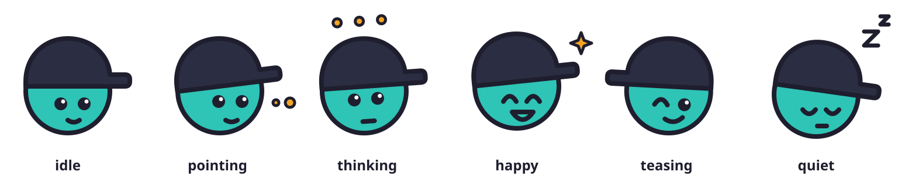

<div align="center">


# Ya-Bro

**A sidekick for your Linux desktop that walks you through real apps, one step at a time.**<br>
It points at the actual button, checks you pressed the right one, and teases you when you didn't.

[](LICENSE)
[](pyproject.toml)
[](docs/guides/getting-started.md#1-what-you-need)
[](docs/PROGRESS.md)


<sub>Real Calculator, real step loop, real overlay, recorded in an isolated headless GNOME session at 2× and replayed with a camera that zooms onto the bro's bubble so you can read it. The bro points at 7, you press 5 on purpose, it teases you, <b>Why?</b> explains the mistake, it forgives you, and it finishes happy.</sub>

</div>

---

The agent is called **Bro**. *"Ya"* is the Arabic "O …!", the way you call a friend over: you say **"Ya bro!"** and Bro comes. The project and repository are named Ya-Bro after that call.

## Why

Guides and tutorials make you switch between a document and the app, and they go stale the moment a button moves. Bro works **in the app you are using**. You say what you want to do; it finds the real control on your screen, points at it, explains why, and waits. It reads the screen to know whether you did it, so it can move on, or say "that's not what I asked for".

## Meet the bro

<p align="center">
  
</p>

One small character with six moods: it **points** at the control, **thinks** when it cannot find it yet, is **happy** when you finish, **teases** a wrong key (only when humour is on), and goes **quiet** when you tell it to back off. The ring around the real control carries the instruction; the bro only looks at it. Humour is a dial (`humour = 0` to `3` in `config.toml`): plain at 0, playful by default, never in errors, when it is unsure, or before a risky step, and one level lower when you seem frustrated. It speaks English or Egyptian Arabic (`language = "auto"`) and `less_chatty = true` mutes the extras.

> **The look is provisional.** This is the working candidate from the [identity study](docs/design/BRO_IDENTITY.md) until the maintainer picks the final one.

## What works today

| | Status |
|---|---|
| Point at a real control with a ring, a bubble and the bro (GNOME 50, Wayland) | ✅ |
| Walk through a task one step at a time from a plan file | ✅ |
| Check the screen: advance by itself, notice a wrong key, explain it with **Why?** | ✅ |
| Next / Why? / Repeat / Stop, and a stop key (Super+Shift+Esc) that always works | ✅ |
| Sees **only the app you allow** (default-deny), or one web tool by origin | ✅ |
| Knowledge packs per app (format, loader, a workbench pack; [run Bro on workbench](docs/guides/workbench.md)) | ✅ |
| Bash hook that sees allowed commands finish (name, exit code, duration only) | ✅ |
| Policy engine and redaction (risk tiers, secret scrubbing) | ✅ |
| First-run consent (nothing is sent unless you say yes), a list of everything sent, state dots on the bro, `panic` and `forget` ([#25](https://github.com/AhmedYousriSobhi/ya-bro/issues/25)) | ✅ |
| "You stuck, bro?" detector with back-off, scored on 62 replayed scenarios | ✅ core, 🚧 no offer bubble yet ([#9](https://github.com/AhmedYousriSobhi/ya-bro/issues/9)) |
| Pointing and struggle evals you can run yourself (`broctl eval ...`) | ✅ |
| Ask in plain words (`broctl ask`): a pack task if one fits, else Claude writes the plan | ✅ built and tested against a stand-in model; not yet run against the live API ([#5](https://github.com/AhmedYousriSobhi/ya-bro/issues/5)) |
| "Do it for me" mode (the bro clicks, narrated) | 🚧 planned ([#27](https://github.com/AhmedYousriSobhi/ya-bro/issues/27)) |
| Voice, English and Arabic | 🚧 planned ([#29](https://github.com/AhmedYousriSobhi/ya-bro/issues/29)) |
| KDE Plasma | 🚧 planned ([#28](https://github.com/AhmedYousriSobhi/ya-bro/issues/28)) |

Pre-alpha: the loop is real and tested; plans come from packs, hand-written files, or Claude (that last path is not yet verified against the live API), and only a few GTK apps are measured. The full picture, including what is *not* done, is in [docs/PROGRESS.md](docs/PROGRESS.md) and the [spec](SPEC.md).

## Quick start

You need Ubuntu 26.04 (or any GNOME 50 desktop) on **Wayland**, `uv`, and `sudo apt install python3-gi gir1.2-atspi-2.0`.

```bash
git clone https://github.com/AhmedYousriSobhi/ya-bro.git && cd ya-bro
uv sync
uv tool install --editable .   # puts `broctl` on your PATH (~/.local/bin): no more `uv run`; keep this checkout
broctl setup                 # pick tools and/or one app; the two required steps default to yes (`--yes` skips asking)
broctl load           # loads the extension without logging out (3 steps it prints)
                             # after an update: `broctl setup`, then log out and in (`broctl doctor` says when)
gnome-calculator &           # then press C, and:
broctl show examples/plans/calculator.toml
```

Click the Calculator window and follow the ring. The full walkthrough, with what each prompt means and fixes for common problems, is the **[user guide](docs/guides/getting-started.md)**.

## While it runs

| Control | Effect |
|---|---|
| Do the step | It reads the screen and moves on by itself |
| **Next** | Skip. On an unfinished step it asks first; a second press skips |
| **Why?** | Explains the step, or your mistake after a wrong key |
| **Repeat** | Shows the step again |
| **Stop** / **Super+Shift+Esc** | Ends everything at once |

## How it works


A small **GNOME Shell extension** draws the ring, the bubble and the bro, and reports window positions. A Python core does the thinking: it finds the control through the accessibility tree (AT-SPI), places the ring using the window position from the extension, and checks the screen after each step. The core only talks to interfaces, so other desktops can be added later. Details: [SPEC](SPEC.md), [architecture decisions](docs/adr/README.md), [step loop (ADR-0026)](docs/adr/0026-show-me-step-loop.md).

## Safety and privacy

- **One app at a time.** Default-deny: until you name an app, Bro sees nothing. `broctl apps list` and `revoke` show and undo it.
- **Visible and interruptible.** Everything it does on screen is drawn, and Stop always works.
- **Show-me only today.** It points; it never types or clicks for you.
- **Screen text is data, not orders.** Words on a page never change what the bro does.
- **Content-free monitoring.** Logs, the shell hook and the struggle detector keep event types and counts only, never typed text or screen content, and the detector is off for every app until you turn it on.
- **Kill switch and receipts.** `broctl panic` stops every Bro process even if the core is frozen, `broctl sent` lists each request that left your machine (kind and size, never content), `broctl forget` deletes what it logged, and dots under the bro show when it is watching, listening, sending or acting.
- **Honest limit.** The GNOME accessibility switch is desktop-wide and the extension runs inside the shell, so the one-app rule is enforced by Bro's code, not by the OS ([details](docs/guides/getting-started.md#9-privacy-what-ya-bro-can-see)).

## The `broctl` command

`broctl <noun> <verb>`, like `kubectl`.

| Group | Commands |
|---|---|
| **Set up** | `doctor` (checks the machine), `setup` (first run, asks before each change), `load` (loads the extension now) |
| **What it may see** | `apps list \| available \| allow \| revoke`, `targets list \| allow \| revoke` (one web tool or command instead of a whole app) |
| **Run a walkthrough** | `ask "what you want to do" [--dry]`, `show <plan.toml>`, `point`, `scope watch` |
| **Knowledge packs** | `pack list \| check <dir>` |
| **Terminal** | `hook install \| uninstall \| print \| status`, `shell watch` |
| **Offers** | `struggle status \| on \| off \| enable APP \| disable APP \| sensitivity N \| watch [--print-only]` (`watch` asks "you stuck, bro?" in a bubble with Yes, No and Not for this app) |
| **Privacy** | `consent show \| revoke`, `sent` (what left this machine), `forget [--everything]`, `panic` (stop everything now) |
| **Words** | `persona say \| list \| lint \| style` (preview and review what the bro says) |
| **Measure** | `eval pointing`, `eval struggle [--sweep]` |

Configuration lives in `~/.config/ya-bro/config.toml` (for example `humour = 0` for plain lines); see [DEVELOPMENT.md](docs/DEVELOPMENT.md) for plans and settings. The API key `broctl ask` uses is looked up in your environment (`ANTHROPIC_API_KEY`), then your system keyring (Secret Service: GNOME Keyring, KWallet), then a git-ignored `.env`. Store it once with `broctl key set` (hidden prompt, never on the command line); `broctl key status` says whether one is set and where it comes from, `broctl key clear` removes it, and `broctl doctor` only says present or missing, never the value. `[brain] model = "..."` and `max_calls` in `config.toml` choose the model and cap the calls per task.

## Documentation

| | |
|---|---|
| [User guide](docs/guides/getting-started.md) | Setup and first run |
| [SPEC.md](SPEC.md) | What we are building and why |
| [docs/adr/](docs/adr/README.md) | Architecture decisions, risks, build plan |
| [docs/PROGRESS.md](docs/PROGRESS.md) | What is done and what is not |
| [docs/design/BRO_IDENTITY.md](docs/design/BRO_IDENTITY.md) | The bro's look: candidates, ranking, artwork |
| [docs/DEVELOPMENT.md](docs/DEVELOPMENT.md) | Developer setup, plan format, layout |
| [docs/PRIOR_ART.md](docs/PRIOR_ART.md) | Who else works on this, and how Ya-Bro differs |
| [CHANGELOG.md](CHANGELOG.md) | Release notes |
| [docs/LICENCES.md](docs/LICENCES.md) | Dependency licences and the compliance gate |

## Contributing

Issues first, then a branch from `dev`, then a pull request into `dev` with the docs updated; `scripts/check.sh` must pass. The full workflow is in [CLAUDE.md](CLAUDE.md) and [docs/DEVELOPMENT.md](docs/DEVELOPMENT.md).

## Licence

[MIT](LICENSE) © 2026 Ahmed Yousri Sobhi
