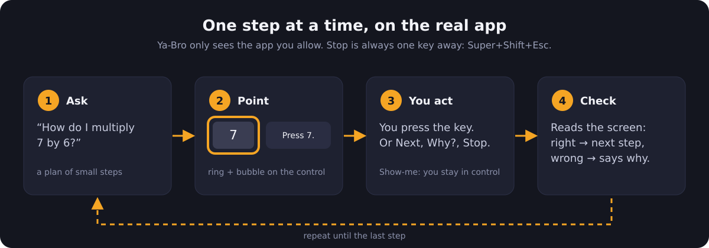

<div align="center">

# Ya-Bro

**A sidekick for your Linux desktop that walks you through real apps, one step at a time.**
It points at the actual button, checks that you pressed the right one, and teases you when you didn't.

[](LICENSE)
[](pyproject.toml)
[](docs/guides/getting-started.md#1-what-you-need)
[](docs/PROGRESS.md)


<sub>Real Calculator and real step loop, recorded in an isolated headless GNOME session, with a narrator track: the bro points at 7, you press 5 on purpose, it teases you, <b>Why?</b> explains the mistake, and it forgives you. The look of the bro itself is not decided yet, so the demo shows only the ring and the bubble.</sub>

</div>

---

*"Ya"* is the Arabic "O …!", as in calling a friend for help: **"Ya bro!"**

## Why

Guides and tutorials make you switch between a document and the app, and they go stale the moment a button moves. Ya-Bro works **in the app you are using**. You say what you want to do; it finds the real control on your screen, points at it, explains why, and waits. It reads the screen to know whether you did it, so it can move on, or say "that's not what I asked for".

## What works today

| | Status |
|---|---|
| Point at a real control with a ring and a short bubble (GNOME 50, Wayland) | ✅ |
| Walk through a task one step at a time from a plan file | ✅ |
| Check the screen: advance by itself, notice a wrong key, explain the mistake with **Why?** | ✅ |
| Next / Why? / Repeat / Stop, and a stop key (Super+Shift+Esc) that always works | ✅ |
| Sees **only the app you allow** (default-deny), or one web tool by origin | ✅ |
| Playful lines, or plain with `humour = 0` | ✅ |
| Ask in plain words and let Claude write the plan | 🚧 next ([#5](https://github.com/AhmedYousriSobhi/ya-bro/issues/5)) |
| "Do it for me" mode (the bro clicks, narrated) | 🚧 planned ([#27](https://github.com/AhmedYousriSobhi/ya-bro/issues/27)) |
| Voice, English and Arabic | 🚧 planned ([#29](https://github.com/AhmedYousriSobhi/ya-bro/issues/29)) |
| "You stuck, bro?" nudges when it notices you struggling | 🚧 planned ([#9](https://github.com/AhmedYousriSobhi/ya-bro/issues/9)) |
| KDE Plasma | 🚧 planned ([#28](https://github.com/AhmedYousriSobhi/ya-bro/issues/28)) |

Pre-alpha: the loop is real and tested, but plans are written by hand for now and only GTK apps are measured. The full picture is in [docs/PROGRESS.md](docs/PROGRESS.md) and the [spec](SPEC.md).

## Quick start

You need Ubuntu 26.04 (or any GNOME 50 desktop) on **Wayland**, `uv`, and `sudo apt install python3-gi gir1.2-atspi-2.0`.

```bash
git clone https://github.com/AhmedYousriSobhi/ya-bro.git && cd ya-bro
uv sync
uv run broctl setup          # pick ONE app to allow; asks before every change
uv run broctl load           # loads the extension without logging out (3 steps it prints)
gnome-calculator &           # then press C, and:
uv run broctl show examples/plans/calculator.toml
```

Click the Calculator window and follow the ring. The full walkthrough, with what each prompt means and fixes for common problems, is the **[user guide](docs/guides/getting-started.md)**.

## What you can do while it runs

| Control | Effect |
|---|---|
| Do the step | It reads the screen and moves on by itself |
| **Next** | Skip. On an unfinished step it asks first; a second press skips |
| **Why?** | Explains the step, or your mistake after a wrong key |
| **Repeat** | Shows the step again |
| **Stop** / **Super+Shift+Esc** | Ends everything at once |

## How it works



A small **GNOME Shell extension** draws the ring and bubble and reports window positions. A Python core does the thinking: it finds the control through the accessibility tree (AT-SPI), places the ring using the window position from the extension, and checks the screen after each step. The core only talks to interfaces, so other desktops can be added later. Details: [SPEC](SPEC.md), [architecture decisions](docs/adr/README.md), [step loop (ADR-0026)](docs/adr/0026-show-me-step-loop.md).

## Safety and privacy

- **One app at a time.** Default-deny: until you name an app, Ya-Bro sees nothing. `broctl apps list` and `revoke` show and undo it.
- **Visible and interruptible.** Everything it does on screen is drawn, and Stop always works.
- **Show-me only today.** It points; it never types or clicks for you.
- **Screen text is data, not orders.** Words on a page never change what the bro does.
- **Content-free logs.** Event types and counts only, never typed text or screen content.
- **Honest limit.** The GNOME accessibility switch is desktop-wide and the extension runs inside the shell, so the one-app rule is enforced by Ya-Bro's code, not by the OS ([details](docs/guides/getting-started.md#9-privacy-what-ya-bro-can-see)).

## The `broctl` command

`broctl <noun> <verb>`, like `kubectl`:

| Command | Does |
|---|---|
| `broctl doctor` | Checks the machine and tells you how to fix each warning |
| `broctl setup` | First-run setup; asks before each persistent change |
| `broctl load` | Loads the extension now, without logging out |
| `broctl apps list \| available \| allow \| revoke` | Manage which app Ya-Bro may see |
| `broctl targets list \| allow \| revoke` | Allow one web tool by origin instead of a whole browser |
| `broctl show <plan.toml>` | Walk through a plan, step by step |
| `broctl pack list \| check <dir>` | List app knowledge packs; validate one |
| `broctl point`, `broctl scope watch` | Draw the ring on the allowed window; watch scope changes |

Configuration lives in `~/.config/ya-bro/config.toml` (for example `humour = 0` for plain lines); see [DEVELOPMENT.md](docs/DEVELOPMENT.md) for plans and settings. `ANTHROPIC_API_KEY` is only checked by `broctl doctor` (present or not, never its value); it is reserved for the Claude brain and unused today.

## Documentation

| | |
|---|---|
| [User guide](docs/guides/getting-started.md) | Setup and first run |
| [SPEC.md](SPEC.md) | What we are building and why |
| [docs/adr/](docs/adr/README.md) | Architecture decisions, risks, build plan |
| [docs/PROGRESS.md](docs/PROGRESS.md) | What is done and what is not |
| [docs/DEVELOPMENT.md](docs/DEVELOPMENT.md) | Developer setup, plan format, layout |
| [docs/PRIOR_ART.md](docs/PRIOR_ART.md) | Who else works on this, and how Ya-Bro differs |
| [CHANGELOG.md](CHANGELOG.md) | Release notes |

## Contributing

Issues first, then a branch from `dev`, then a pull request into `dev` with the docs updated; `scripts/check.sh` must pass. The full workflow is in [CLAUDE.md](CLAUDE.md) and [docs/DEVELOPMENT.md](docs/DEVELOPMENT.md).

## Licence

[MIT](LICENSE) © 2026 Ahmed Yousri Sobhi
