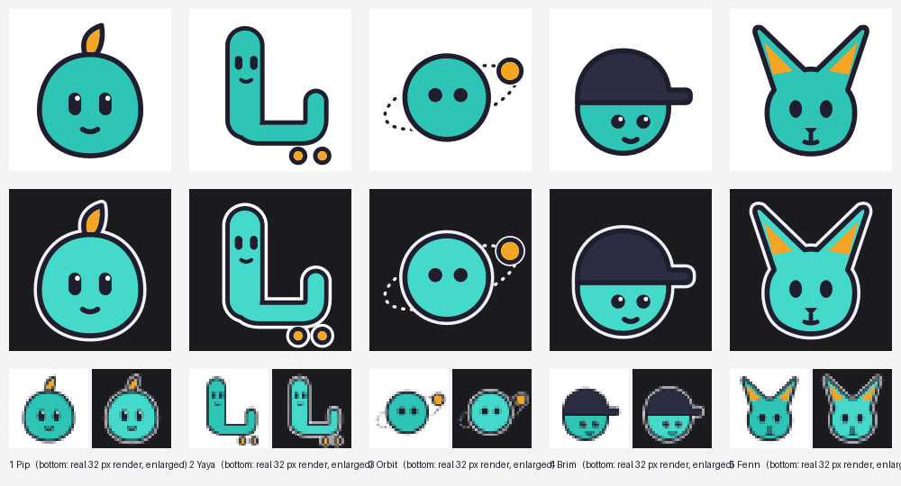
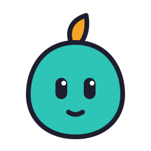
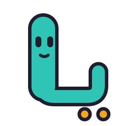
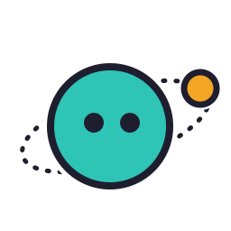
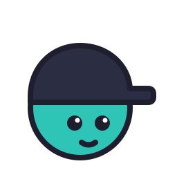
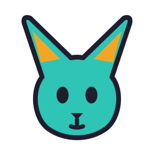
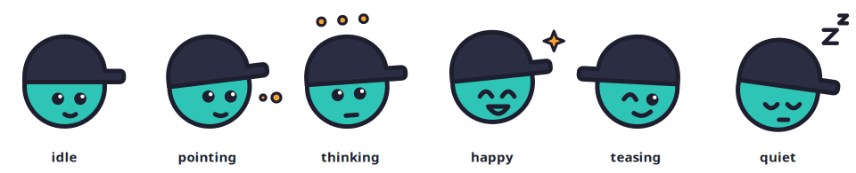
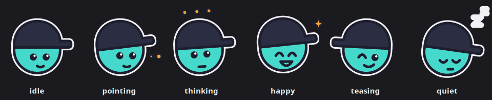

# The bro's identity: five candidates and a recommendation

- Status: Proposal (the maintainer makes the final call)
- Issue: #96
- Artwork: [`docs/assets/identity/`](../assets/identity/) (SVG), previews in [`docs/assets/identity/preview/`](../assets/identity/preview/)
- Reads with: [SPEC.md](../../SPEC.md) §2, §4, [ADR-0006](../adr/0006-overlay-rendering.md) (overlay), [ADR-0013](../adr/0013-personality-tone-and-humor.md) (tone and humour), [ADR-0019](../adr/0019-internationalization-and-rtl.md) (bidi), [ADR-0023](../adr/0023-gnome-shell-extension-bridge.md) (GNOME extension)

## 1. Design principles

These come from the repo's own decisions, not from taste.

1. **Playful but trustworthy.** ADR-0013 makes humour a dial (0 to 3). It never appears in errors, risk confirmations or anything about credentials. The character must therefore look right with no joke at all: at humour 0 it is a calm guide, not a clown with the jokes switched off.
2. **Never annoying.** PRIOR_ART.md names the Office Assistant as the cautionary ancestor: it interrupted and did not back off. The look must make backing off visible, and the "quiet" state has to read as *resting*, not *sulking*. There is no idle fidgeting, and nothing moves unless the state changes.
3. **Visible and interruptible.** SPEC §7: everything the bro does is on screen. The character must be clearly a *character* and not a window, button or notification, so users know which thing is the bro and can click it to stop.
4. **The ring is the hero, not the bro.** The ring around the real control carries the instruction. The bro only *looks at* it. So the bro stays small, never uses the ring's amber as its body colour, and its gaze always resolves toward the ring.
5. **Accessible.** State is carried by shape (eyes, cap angle, mouth, a small mark), never by colour alone. A dark ink outline plus a light halo keeps the silhouette on white, black, mid-grey and busy app content. Reduced motion gets static frames. Nothing flashes.
6. **Small first.** It must read at 32 px in the overlay and at 16 px as a favicon. Anything that only works at 256 px is decoration.
7. **Arabic-flavoured, not Arabic-themed.** "Ya" is how you call a friend. The warmth comes from voice and behaviour. It does not come from costume: no turbans, lamps, camels or desert props.

## 2. Shared palette and construction

All five candidates use one palette, so the comparison is about form, not colour.

| Token | Light | Dark | Use |
|---|---|---|---|
| `--bro-body` | `#2EC4B6` | `#45D9CB` | body/head fill |
| `--bro-cap` | `#2B2D42` | `#3A3D5C` | cap (candidate 4 only) |
| `--bro-ink` | `#1E1E2E` | `#1E1E2E` | outline, eyes, mouth (same as `.yabro-bubble`) |
| `--bro-halo` | `#FFFFFF` | `#F0F0F5` | outer halo stroke |
| `--bro-accent` | `#F5A524` | `#F5A524` | **owned by the ring** (`.yabro-ring`); the bro uses it only for marks about the target |

**Amber decision.** The ring keeps `#F5A524`. The bro's body is teal, so the bro and the target highlight never compete at 32 px. The current placeholder avatar (`.yabro-avatar`, amber) should change to teal when the art lands. Amber appears on the bro only in marks that refer to the target, such as gaze dots, the sparkle and the thinking dots. That ties "where the bro looks" to "what the ring marks".

**Contrast (computed, WCAG ratio).**

| Pair | Ratio |
|---|---|
| ink on body (light) | 7.6:1 |
| ink on body (dark) | 9.4:1 |
| ink outline vs white page | 16.4:1 |
| halo `#F0F0F5` vs dark page `#1B1B1F` | 15.1:1 |
| body vs white | 2.2:1 |

Body vs white is why the ink outline is mandatory. Cap vs dark page is 1.3:1, which is why the halo is mandatory.

**SVG mechanics.** Colours live in a `<style>` block with classes, plus an `@media (prefers-color-scheme: dark)` override. The dark tokens are for browser and README contexts (GitHub's `` follows the viewer's OS colour scheme). Assume St (gdk-pixbuf/librsvg) and cairosvg ignore the `@media` block: the overlay and the GIF use the light variant, which is built to sit on any background thanks to the halo. Unverified in librsvg. The `--bro-*` names above are documentation names only: the SVGs use the classes `.body .cap .halo .ink .line .glint .fx .fxl` with hex values. To recolour, override those classes or replace the hex strings; setting CSS variables does nothing. There are no fonts, images or scripts. The only text is the English labels on the states sheet, which use the generic `sans-serif`.

## 3. The five candidates

### Candidate 1: Pip, a face on a pebble

**Concept.** A soft egg-shaped body with two pill eyes, a small smile and one amber tuft.

**Personality and voice.** Gentle, patient, a little shy. The tutor who never sighs.
- "Take your time. It's the second icon."
- "Nice, that's the one."
- "Not that one, but close. Try the menu on the left."
- AR: "خد وقتك، أنا معاك." (Take your time, I'm with you.)

**Silhouette and palette.** Egg body (one path) plus a teardrop tuft. Shared palette; the tuft is amber.

**States.**
| State | Change |
|---|---|
| idle | as drawn |
| pointing | pupils shift toward the target; the tuft bends toward it |
| thinking | eyes up; the tuft curls |
| happy | eyes become `^ ^` arcs; small hop |
| teasing | one eye squints; mouth becomes a crooked line |
| quiet | eyes closed as lines; the tuft droops; body sinks 4 % |

**Pointing.** Weak. Only the eyes and a 30 px tuft indicate direction, and at 32 px the tuft is about 4 px.

**Sizes.**
| Size | Result |
|---|---|
| 96 px | good |
| 48 px | good |
| 32 px | reads as a face, but the tuft and gaze are marginal |
| 16 px | a teal dot with eyes |

**Build.** The body as a circle or squircle can be pure St. The tuft needs SVG frames. Effort: about 1 day.

**Pros.** The friendliest and calmest; lowest annoyance risk; gender-neutral.

**Cons and risks.**
- Generic: blob-with-leaf mascots are everywhere.
- In review it reads as a fruit (a teal apple or turnip).
- Weak pointing.

**Humour.** 0 to 2. It looks odd being cheeky at level 3.

### Candidate 2: Yaya, the word يا as a figure

**Concept.** The word يا is drawn so that the final alif is the bro's body (with a face), the joining stroke is its base, and the initial ya's tooth is a raised hand calling "Ya!". The two dots stay under the tooth.

**Letterform check.**
- In يا the ya takes its **initial** form: a short tooth with two dots below, joined left to the alif. The big swooping bowl exists only in isolated or final ي.
- So a character built on the bowl would not spell يا. This one keeps the correct joined form.
- Moving the two dots above the tooth would make تـ (ta). Don't.

**Personality and voice.** The friend who calls you over from across the room.
- "Ya bro! Over here, this button."
- "Got it in one."
- "That was Undo. We wanted Redo, one to the right."
- AR: "يا برو! تعالى هنا، الزرار ده." (Ya bro! Come here, this button.)

**Silhouette and palette.** Two rounded strokes plus two dots. The body is teal; the dots are amber.

**States.**
| State | Change |
|---|---|
| idle | as drawn |
| pointing | the face looks right; the tooth "hand" lifts |
| thinking | the face looks up; the dots pulse in turn (static: both visible) |
| happy | the hand waves; `^ ^` eyes |
| teasing | squint and a crooked mouth |
| quiet | the alif bends forward at the top; eyes closed |

**Pointing.** Only toward the right.
- **It cannot be mirrored**: a mirrored يا is not Arabic and would look broken to exactly the audience it honours.
- For targets on the left, only the eyes turn.

**Sizes.**
- 96 and 48 px: good.
- 32 px: the face is tiny (the alif is about 6 px wide). It reads as a Latin "L" or "U" to non-Arabic readers.
- 16 px: an "L".

**Build.** Two rounded strokes can be approximated by St boxes with radius, but the joints look clumsy. SVG frames are the realistic route. Effort: about 1.5 days plus native calligraphic review.

**Pros.**
- The most original and culturally grounded of the five.
- Makes "Ya" literal.
- Lovely as a wordmark.

**Cons and risks.**
- Most of the world sees an "L" with feet.
- Expression space is tiny.
- No mirroring.
- It turns script into a cartoon. Some readers may find that disrespectful, so it needs native-reader sign-off before use.

**Humour.** 0 to 2.

**Honest verdict.** It is excellent as a **wordmark/lockup** next to the character ("Ya-Bro" with يا set in this rounded stroke style). It is weak as the animated sidekick.

### Candidate 3: Orbit, an orb with a moon

**Concept.** A teal orb with two eyes. A small amber moon on a dotted orbit always sits on the side of the target.

**Personality and voice.** Calm, a little cosmic, very low-key.
- "Your target's over there."
- "Done. Next one."
- "Different button, same idea, look right."
- AR: "خطوة خطوة، ماشي؟" (Step by step, OK?)

**Silhouette and palette.** Circle, dotted ellipse, small circle. Shared palette.

**States.** The moon's position is the pointer.
| State | Change |
|---|---|
| idle | as drawn |
| thinking | the moon circles |
| happy | the moon pops up and the eyes become arcs |
| teasing | the moon bonks the orb |
| quiet | eyes closed; the moon parks below |

**Pointing.** Clear at 96 px. At 32 px the orbit line vanishes, and the moon becomes a stray dot near the ring, which competes with the pointer dot (`.yabro-pointer`).

**Sizes.** Good at 96 px. Poor at 48 and 32 px: it becomes a generic emoji face. At 16 px it is a teal circle.

**Build.** Pure St: circles plus a dashed ring. Effort: about 0.5 day.

**Pros.** The easiest to build; calm.

**Cons and risks.**
- A glowing orb companion that floats over the screen is the form closest to the Zelda fairy the brief must not evoke.
- It also reads as a planet or Saturn icon.
- The moon duplicates the existing pointer dot.
- A "watching eye" reading is a real risk for a tool that monitors struggle.

**Humour.** 0 to 1.

### Candidate 4: Brim, a round head with a cap

**Concept.** A round teal head wearing a dark cap. The visor **is** the pointer: it always aims at the ring. The cap is the expressive part:
- tipped up when looking,
- tilted when happy,
- **flipped backwards when teasing**,
- pulled down over the eyes when quiet.

**Personality and voice.** The friend next to you on the couch: relaxed, confident, a bit cheeky, always on your side.
- "This one, bro. Top right."
- "Clean. Next."
- "Ha, that's Undo. We want Redo, right next to it."
- AR: "تمام يا برو، كده صح!" (Nice, bro, that's right!)

**Silhouette and palette.**
- Circle head, cap dome and one rounded visor bar.
- Head `#2EC4B6`/`#45D9CB`, cap `#2B2D42`/`#3A3D5C`, ink outline, light halo.
- The silhouette (a circle with one bar sticking out) is unique among the five at 16 px.

**States** (see the [states sheet](#5-states-sheet-for-brim)).
| State | Shape change | Extra mark |
|---|---|---|
| idle | eyes centre-right, small smile | none |
| pointing | eyes to the target; the cap tips up 7°; the head leans 4 px toward the target | two amber gaze dots growing toward the target |
| thinking | eyes up-left; flat mouth; head tilts −4° | three amber dots above (staggered; static all three) |
| happy | `^ ^` eyes; open grin; hops 8 px; cap tilts −6° | one amber sparkle |
| teasing | **cap flipped backwards**; one eye winks; smirk | none |
| quiet | cap pulled down 8° over closed eyes; sinks 6 px | small "z z" |

**Pointing.**
- The frames face right.
- Mirror with `scale_x = -1` about the anchor for targets on the left or for RTL.
- For targets above or below, rotate the pose by the gaze angle, clamped to ±20°, about the anchor, and shift the pupils ±6 px vertically.

**Sizes.**
| Size | Result |
|---|---|
| 96 px | full detail |
| 48 px | full detail; the recommended overlay size |
| 32 px | head, cap, visor and eyes survive; glints and amber marks blur, so drop them (the ring does the pointing) |
| 16 px | the cap-and-visor silhouette still reads; use `bro-mark.svg`, which has no mouth |

**Build.**
- **Route A, recommended.** Ship the six `states/*.svg` frames. Show them in an `St.Icon` (`gicon` from `Gio.FileIcon`) and swap per state. Do flip, lean and hop with St actor transforms (`scale_x`, `rotation_angle_z`, `translation_y`, with `pivot_point` at the anchor).
- **Route B, pure St/CSS.**
  - Head: a circle `St.Widget`.
  - Cap: a widget with top-only `border-radius`.
  - Visor: a pill widget.
  - Eyes: circles.
  - Arcs and mouth: one-sided borders with radius, which are less reliable and need testing.
- Effort: Route A is about 0.5 day; Route B is about 2 days.

**Pros.**
- The best 32 px and 16 px recognition of the five.
- The pointing relationship is built into the silhouette.
- The expressive range comes from one rigid part, the cap.
- Mirrors cleanly for RTL.
- "Bro" without a single word.

**Cons and risks.**
- A cap can read as gendered or as cocky "bro culture". At humour 3 with a backwards cap it could grate.
- Cap-wearing faces exist as generic emoji, so it is distinctive but not unprecedented.
- The dark cap needs the halo on dark themes (built in).

**Humour.** 0 to 3. At humour 0 the teasing frame is never used: a wrong press shows *pointing* toward the right target with a plain line instead.

### Candidate 5: Fenn, a big-eared fox kit

**Concept.** A round fox-kit face with oversized ears. The ears are the expressive part.

**Personality and voice.** Curious, alert, quick to notice.
- "Heard that? Wrong key. Try Ctrl+Shift+E."
- "Got it!"
- "Over here, the button with the arrow."
- AR: "سامعك يا برو، عايز تعمل إيه؟" (I hear you, bro, what do you want to do?)

**Silhouette and palette.** One head-and-ears path with amber inner ears. Shared palette.

**States.**
| State | Change |
|---|---|
| idle | as drawn |
| pointing | head and ears turn toward the target |
| thinking | one ear folds |
| happy | ears up, eyes as arcs |
| teasing | one ear flops, smirk |
| quiet | both ears flat, eyes closed |

The ears give it the widest emotional range of the five.

**Pointing.** Good: the ears and nose turn.

**Sizes.** Good at 96 and 48 px; ears dominate at 32 px. At 16 px it reads as "some animal", possibly a cat or bat.

**Build.** Triangular ears need SVG frames. Ear poses multiply the frame count (about 10). Effort: about 2 days.

**Pros.** The most expressive; cute; a regional animal used without desert props.

**Cons and risks.**
- Proximity to well-known fox marks in the browser and open-source world.
- Cute-animal mascots skew childish for a work tool.
- The most frames to maintain.
- It slides easily into "desert" theming that the principles forbid.

**Humour.** 1 to 3. At level 0 the animal still reads as playful.

## 4. Comparison

Scores are 1 to 5, where 5 is best. For "annoyance risk", 5 means *least* risky. The weights reflect what fails the product, not what looks good in a README.
- Recognisability at 32 px (×3) and annoyance risk (×3) matter most: the bro lives at that size and gets switched off if it grates.
- Build ease, expressiveness, friendliness and originality are weighted ×2.
- Arabic/RTL fit and README appeal are weighted ×1, because voice and copy carry most of the Arabic warmth and the README is seen once.

| Criterion (weight) | 1 Pip | 2 Yaya | 3 Orbit | **4 Brim** | 5 Fenn |
|---|---|---|---|---|---|
| Recognisable at 32 px (×3) | 4 | 3 | 2 | **5** | 4 |
| Easy to build in St (×2) | 3 | 3 | 4 | **5** | 1 |
| Expressiveness (×2) | 3 | 2 | 2 | **4** | 4 |
| Friendliness (×2) | 5 | 3 | 3 | **4** | 4 |
| Annoyance risk, 5 = low (×3) | 4 | 4 | 3 | **3** | 3 |
| Originality / trademark safety (×2) | 2 | 5 | 2 | **4** | 2 |
| Arabic / RTL fit (×1) | 3 | 4 | 2 | **3** | 3 |
| README appeal (×1) | 3 | 4 | 2 | **4** | 4 |
| **Weighted total (max 80)** | 56 | 55 | 41 | **65** | 50 |
| Plain average | 3.4 | 3.5 | 2.5 | 4.0 | 3.1 |

**Reading the totals.**
- Brim leads clearly. It wins the heaviest criterion (32 px) and build ease, and loses points only on annoyance risk.
- Pip and Yaya tie on points but fail differently:
  - Pip is safe and forgettable.
  - Yaya is memorable but cannot do the job of an animated pointer (no mirroring, tiny face).
  - The plain average would rank Yaya above Pip, which is exactly the mistake the weights prevent.
- Orbit is last on substance: it carries the Navi resemblance risk and fails at 32 px.

## 5. States sheet for Brim

Source: [`bro-states.svg`](../assets/identity/bro-states.svg). Frames: [`states/`](../assets/identity/states/) contains `idle`, `pointing`, `thinking`, `happy`, `teasing` and `quiet`.

**Frame contract** (for the extension and for `scripts/dev/record_demo.py`):
- **Structure.** Every frame is `viewBox="0 0 256 256"` with the same element order and ids: `#pose > halo, halo, #head, #cap, #eyes, #mouth, #fx`. Only attributes differ, so frames swap without jitter.
- **Anchor.** Head bottom-centre at **(116, 228)** in frame units, which is (0.453, 0.891) as a pivot point. Rotate, scale and mirror about this point.
- **Direction.** Frames face **right**. For a target on the left, or in RTL when the bro sits to the right of the bubble, set `scale_x = -1` about the anchor. The teasing frame is already "backwards", so mirroring it keeps it readable.
- **Gaze.**
  1. In screen coordinates (y down), angle = atan2(dy, |dx|), where (dx, dy) = target centre − anchor.
  2. Mirror first if dx < 0.
  3. Clamp to ±20° and apply as `rotation_angle_z` about the anchor, after mirroring. Beyond ±20° (target well above or below), keep the clamp: the ring carries the precision.
  4. The sign convention of Clutter's `rotation_angle_z` on a mirrored actor was not verified; check it once against a target above and below.
- **Sizes.** Use 48 px in the overlay. That is bigger than the current 32 px `.yabro-avatar`, so `AVATAR_GAP` in `extension/overlay.js` (40) should become about 56. At 32 px, hide `#fx` and the glints.
- **Motion.** State changes cross-fade in 120 ms.
  - happy: one 8 px hop (200 ms).
  - thinking: the three dots step in turn at 2 Hz at most.
  - quiet: no breathing loop. It just sits.
- **Reduced motion** (`org.gnome.desktop.interface enable-animations = false`): swap frames instantly, with no hop and no dot cycling (all three dots shown).
- **Flashing.** Nothing flashes or blinks faster than 3 Hz, ever.

## 6. Ranked recommendation

1. **Brim (candidate 4).** It is the only candidate whose silhouette survives 16 px *and* whose shape points at the target by itself: the visor is a built-in arrow that still reads as a character. It also gives five distinct states from one rigid part, so it is cheap to build with St transforms over six SVG frames, and it mirrors for RTL.
2. **Pip (candidate 1).** It is the fallback if the cap reads as too "bro" in testing. It is the friendliest and least likely to annoy. It needs a stronger signature than the tuft before it can be a brand: today it reads as a teal fruit.
3. **Yaya (candidate 2), as the wordmark, not the sidekick.** Set "يا" in this rounded stroke style next to the Brim mark in the README header and the about dialog. That keeps the cultural grounding without asking the script to do a cartoon's job.

Not recommended:
- **Fenn**: frame cost, fox-mark proximity, too cute for a work tool.
- **Orbit**: closest to the forbidden reference, fails at 32 px.

**What the maintainer should decide.**
1. Brim or Pip as the character.
2. Whether Yaya becomes the wordmark. This needs a native-reader check of the letterforms.
3. The overlay avatar size: 48 px is recommended.
4. Whether the cap flip is allowed at humour 1, or only at 2 and above.
5. Sign-off on every Arabic line in this note. ADR-0013 assigns Egyptian Arabic review to the maintainer; these lines are drafts.

**Risks for Brim and their mitigations.**
| Risk | Mitigation |
|---|---|
| The cap reads as gendered or frat | Keep the voice self-deprecating (ADR-0013). Never flip the cap during the user's frustration (humour drops a level, so use the plain pointing frame). Test the reading explicitly (below). |
| Teasing grates | The teasing frame shows for one step at most and only at humour ≥ 1. The "less chatty" toggle also suppresses it. |
| Dark cap on a dark theme | The halo is mandatory, so never ship the frames without it. |

**Cheap test of the top two (Brim vs Pip).**
- **5-person preference check (1 hour).**
  1. Show each person the two states sheets at real size over a screenshot of LibreOffice. Use at least two Arabic speakers and at least two women.
  2. Ask: (a) where is it looking, (b) which state is "you got it wrong", (c) one word for its personality, (d) which one you would turn off first.
  3. Brim wins if ≥ 4 of 5 answer (a) correctly and no more than 1 says "annoying" or "cocky".
- **1-week dogfood.**
  1. The maintainer runs Brim for 3 days, then Pip for 3 days, at the default humour.
  2. Log how often humour is lowered and how often the avatar is clicked to dismiss (ADR-0013's 40 % rule).
  3. Pick the one with fewer dismissals.

## 7. Logo mark and README hero

- **Mark.**
  - [`bro-mark.svg`](../assets/identity/bro-mark.svg) is Brim redrawn on a 32 px grid: head, cap, visor and two eyes, with a 1.5 px outline and a 3 px halo.
  - It has no mouth, glints or amber, because they do not survive 16 px.
  - Use it for the favicon, the GitHub social avatar, the extension icon and the panel indicator.
  - Do not scale the 256 px frames down to 16 px. Use the mark.
- **README hero.**
  - Use `candidate-4-brim.svg` (idle), or `states/pointing.svg` next to an amber ring around a real control.
  - The pointing composition is the better hero, because it explains the product in one image: a bro looking at the thing you need.
  - Size it at 160 to 200 px. Put the text "Ya-Bro" plus the optional يا wordmark beside it, not on it.
  - The SVGs adapt to GitHub dark mode through `prefers-color-scheme`.
- **Demo GIF.**
  - Composite `states/*.svg` at 48 px at the overlay's avatar position: the bubble's top-left minus `AVATAR_GAP`, top-aligned with the bubble. The frame faces right toward the bubble and target.
  - Use pointing while a step waits, happy on success, teasing on a wrong press (humour ≥ 1) and thinking while the bro checks the screen.

**Do**
- Keep the bro smaller than the bubble and away from the ring. The ring is the instruction.
- Always render the ink outline and the light halo.
- Change state by shape: eyes, cap angle, mouth, one mark.
- Mirror with `scale_x = -1` about the anchor.
- Keep amber for the ring and target-related marks.
- Show *quiet* when the bro backs off, then get out of the way.

**Don't**
- Don't recolour the body amber, or use colour alone to signal a state.
- Don't animate while idle, blink-loop, bounce on a timer or flash.
- Don't show teasing at humour 0, during errors, on R2/R3 confirmations, or after repeated failures.
- Don't add props: no turbans, lamps, camels, desert scenes, flags or wings.
- Don't mirror the Yaya wordmark, or move the dots of ي.
- Don't scale the hero frames to favicon size. Use `bro-mark.svg`.

## 8. Files

| File | What |
|---|---|
| `docs/assets/identity/candidate-1-pip.svg` … `candidate-5-fenn.svg` | the five heroes, 256×256 |
| `docs/assets/identity/bro-states.svg` | Brim's six states with labels |
| `docs/assets/identity/states/{idle,pointing,thinking,happy,teasing,quiet}.svg` | Brim frames, same structure, facing right |
| `docs/assets/identity/bro-mark.svg` | favicon mark, 32×32 grid |
| `docs/assets/identity/preview/*.png` | review renders: each candidate on light, dark, mid-grey and busy backgrounds at 160, 32 and 16 px; the overview; the states sheet in light and dark; raw 32 px renders |

The Brim frames, the states sheet and the Brim hero were generated by a throwaway script that was not committed. The committed SVGs are the source of truth: edit them directly and keep the frame contract in §5.

The previews were rendered with cairosvg, which ignores the dark `@media` block, so the dark previews substitute the dark tokens. They were not checked in librsvg or in a live GNOME Shell. Check them there before shipping (`rsvg-convert` was not installed on the design machine).
